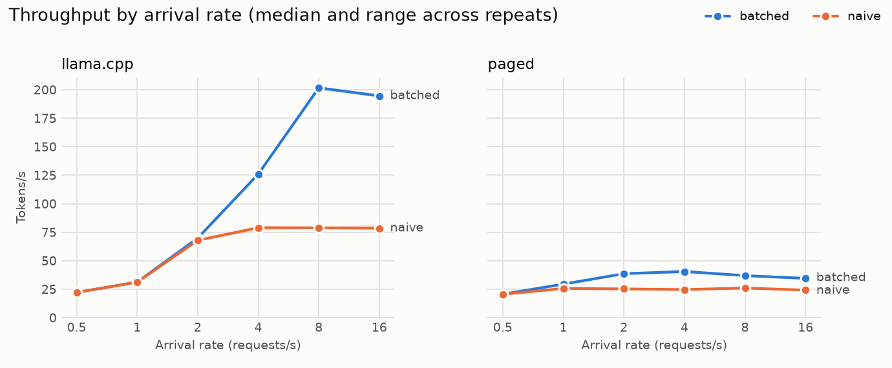
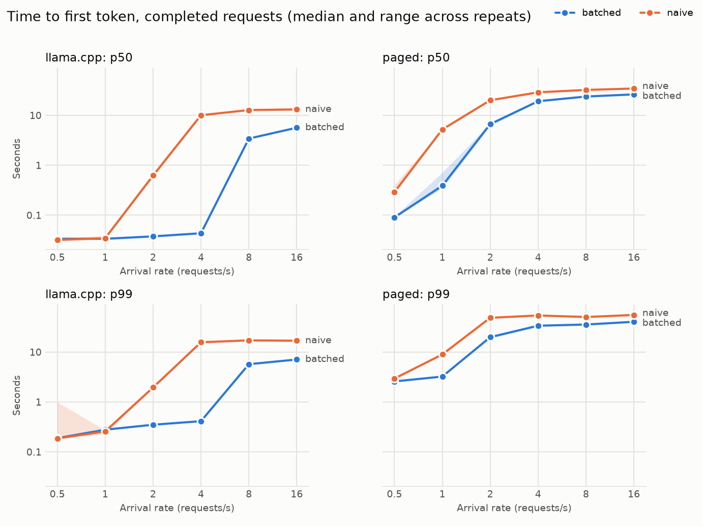
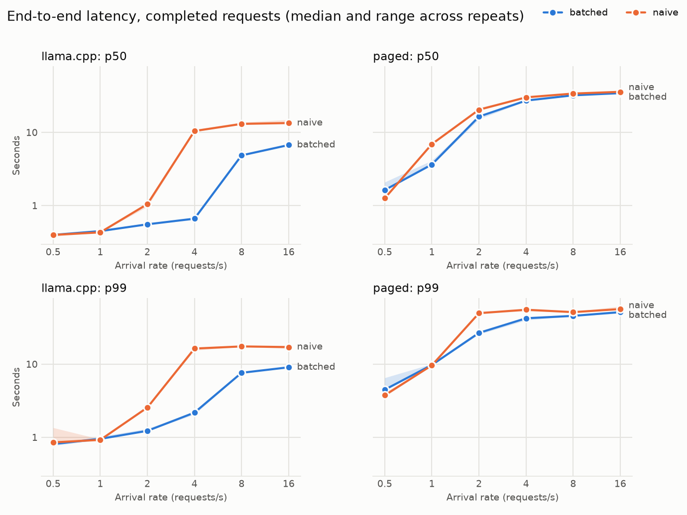
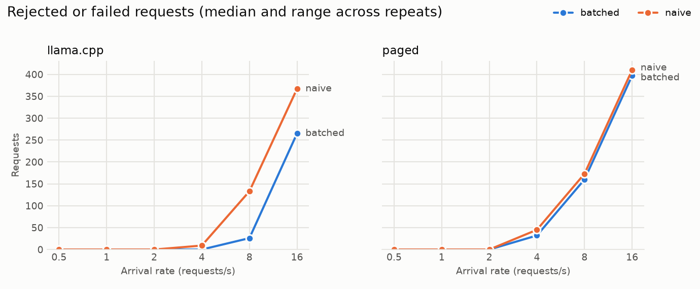

# BatchStream Inference Engine

An inference engine with continuous batching and SSE streaming, with its own scheduler, KV-cache memory manager, streaming API and benchmarks. It runs on two backends: llama.cpp, and a hand-written PyTorch model with a paged KV cache and a C++ paged-attention function.

**Main result:** on the same backend, model and workload, continuous batching beats serving one request at a time under load. Peak throughput is **2.55x** higher on llama.cpp and **1.56x** higher on the paged backend. At 4 req/s on llama.cpp, end-to-end p99 latency falls from 16.33 s to 2.17 s.

Benchmark and measurement tables come from the files in `results/`. A few diagnostic readings aren't saved there, and each one says so. Read [Limitations](#limitations) before quoting any of these numbers.

## Architecture

```
                 POST /generate {prompt, max_tokens}
                                 |
                                 v
  +-----------------------------------------------------------------+
  | api.py: validation (422), SSE streaming, disconnect -> cancel   |
  +-----------------------------------------------------------------+
                  |  submit()                ^  tokens
     too large -> 413                        |
     queue full -> 429                       |
                  v                          |
  +-----------------------------------------------------------------+
  | scheduler.py                                                    |
  |   bounded FIFO queue --> KV budget check --> active sequences   |
  |                                                                 |
  |   NaiveScheduler:    one request runs to completion at a time   |
  |   BatchingScheduler: admit -> step -> emit -> remove -> repeat  |
  +-----------------------------------------------------------------+
         |  kv_budget.py: reserves a request's worst case
         |  backend interface: tokenize, start_sequence, step, release
         v
  +----------------------------+   +--------------------------------+
  | backend/llamacpp.py        |   | backend/paged.py               |
  |  llama.cpp low-level API   |   |  torch_model.py: own forward   |
  |  one shared KV cache       |   |  block_allocator.py: KV blocks |
  |  managed by llama.cpp      |   |  csrc/paged_attention.cpp      |
  +----------------------------+   +--------------------------------+
```

- **Continuous batching:** after every decode step, finished sequences leave and waiting ones join, so a short request isn't stuck behind a long one.
- **Chunked prefill:** long prompts are processed a chunk per step, mixed with other sequences' generation, so they stall active streams less.
- **Backpressure:** the waiting queue is bounded. A full queue returns 429, and a request that could never fit returns 413.
- **Memory manager:** with llama.cpp, it's a token-based admission controller, because llama.cpp manages its own KV cache. With the paged backend, it's real block-level management: fixed-size blocks, a free list, and a block table per sequence.
- **Failure handling:** a client disconnect cancels its request and releases its budget. A backend error ends the affected requests with an `error` event, and the server keeps serving.

## How to run

Requires Python 3.11+. The project was developed and tested on an Apple M1 Mac, but these steps haven't been run from a clean install.

```
python -m venv .venv && source .venv/bin/activate
pip install -r requirements.txt
python setup.py build_ext --inplace
```

Rerun the last command after changing anything in `csrc/`.

**Models** go in `models/`, which git ignores:
- **llama.cpp:** `qwen2.5-0.5b-instruct-q4_k_m.gguf`
- **Paged backend:** the files from [`Qwen/Qwen2.5-0.5B-Instruct`](https://huggingface.co/Qwen/Qwen2.5-0.5B-Instruct), in `models/qwen2.5-0.5b-instruct/`

The paged backend also uses the GGUF for its tokenizer, so both backends tokenize identically. Expected checksums are in `results/phase8/environment.json`.

| Task | Command |
|---|---|
| **Run tests** | `pytest -q` |
| **Start the server** (llama.cpp, batched) | `uvicorn server.api:build_app --factory --app-dir src` |
| **Run the benchmark** | `PYTHONPATH=src python bench/loadgen.py` |
| **Build the report and plots** | `python bench/report.py` |
| **Run the paged memory and C++ measurements** | `PYTHONPATH=src python bench/phase7.py` |

Stream a response:

```
curl -N -X POST localhost:8000/generate \
  -H 'Content-Type: application/json' \
  -d '{"prompt":"The capital of France is","max_tokens":5}'
```

## Results: batched vs naive on each backend

These tables compare **scheduling modes on one backend**, which is the fair comparison and the main result. Each value is the median of 3 repeats. Ranges are in `results/phase8/summary.csv`.

**Method:**
- Open-loop Poisson arrivals at 6 rates for 30 s each, so requests keep arriving whether or not the server keeps up.
- The same seed, prompts and `max_tokens` for every run, with prompts from 4 to 277 tokens and greedy sampling.
- Latency is measured from each request's scheduled arrival time, so a late load generator can't hide queueing delay.
- Limits are 8 concurrent sequences, a queue of 32, and a KV budget of 4096 tokens.
- Each backend runs in a fresh process for each repeat, after swap settles.

Hardware and versions are in `results/phase8/environment.json`.

### llama.cpp

| Rate (req/s) | Mode | Tokens/s | TTFT p50 (s) | TTFT p99 (s) | End-to-end p50 (s) | End-to-end p99 (s) | Rejected |
|---|---|---|---|---|---|---|---|
| 0.5 | batched | 22.2 | 0.03 | 0.19 | 0.40 | 0.81 | 0 |
| 0.5 | naive | 22.2 | 0.03 | 0.19 | 0.40 | 0.85 | 0 |
| 1 | batched | 31.2 | 0.03 | 0.28 | 0.45 | 0.95 | 0 |
| 1 | naive | 31.2 | 0.03 | 0.26 | 0.43 | 0.92 | 0 |
| 2 | batched | 69.8 | 0.04 | 0.35 | 0.55 | 1.23 | 0 |
| 2 | naive | 67.9 | 0.62 | 1.95 | 1.05 | 2.55 | 0 |
| 4 | batched | 126.0 | 0.04 | 0.41 | 0.66 | 2.17 | 0 |
| 4 | naive | 79.0 | 10.05 | 15.69 | 10.45 | 16.33 | 9 |
| 8 | batched | 201.8 | 3.43 | 5.70 | 4.85 | 7.61 | 26 |
| 8 | naive | 78.9 | 12.76 | 17.11 | 13.07 | 17.47 | 133 |
| 16 | batched | 194.6 | 5.65 | 7.08 | 6.72 | 9.05 | 265 |
| 16 | naive | 78.5 | 13.09 | 16.82 | 13.43 | 17.11 | 367 |

### Paged backend

| Rate (req/s) | Mode | Tokens/s | TTFT p50 (s) | TTFT p99 (s) | End-to-end p50 (s) | End-to-end p99 (s) | Rejected |
|---|---|---|---|---|---|---|---|
| 0.5 | batched | 20.6 | 0.09 | 2.58 | 1.63 | 4.48 | 0 |
| 0.5 | naive | 20.5 | 0.29 | 2.94 | 1.26 | 3.76 | 0 |
| 1 | batched | 29.5 | 0.39 | 3.23 | 3.64 | 9.75 | 0 |
| 1 | naive | 25.7 | 5.21 | 8.95 | 6.92 | 9.63 | 0 |
| 2 | batched | 38.6 | 6.68 | 19.84 | 16.45 | 26.76 | 0 |
| 2 | naive | 25.3 | 20.02 | 48.38 | 20.42 | 49.75 | 0 |
| 4 | batched | 40.6 | 19.15 | 33.63 | 27.23 | 42.36 | 32 |
| 4 | naive | 24.7 | 28.86 | 53.89 | 30.17 | 55.43 | 45 |
| 8 | batched | 36.9 | 23.79 | 35.51 | 32.15 | 45.70 | 160 |
| 8 | naive | 26.0 | 32.25 | 50.24 | 33.97 | 51.41 | 173 |
| 16 | batched | 34.5 | 26.25 | 40.29 | 34.43 | 51.43 | 397 |
| 16 | naive | 24.2 | 34.43 | 55.12 | 35.88 | 56.61 | 410 |

### Plots









## Results: comparing the two backends

llama.cpp peaks at 201.8 tok/s batched, and the paged backend peaks at 40.6 tok/s. **This compares two different implementations, not two scheduling approaches, and it isn't a fair speed contest:**

| | llama.cpp | Paged backend |
|---|---|---|
| **Device** | Metal | CPU |
| **Weights** | 4-bit (Q4_K_M) | bf16 |
| **Implementation** | Mature, optimized C++ engine | Python model with one C++ function |

## Results: paged KV memory and C++ attention

These come from `bench/phase7.py`, with the files in `results/phase7/`.

**Memory**, for 8 requests with up to 4 running at once:

| Approach | Peak KV memory |
|---|---|
| **Paged blocks actually used** | 3.4 MiB |
| **Reserving `prompt + max_tokens`, as the scheduler does** | 3.9 MiB (14.3% saving from paging) |
| **Reserving a full 4096-token context per request** | 192 MiB (98.2% saving from paging) |

The 14.3% figure is the realistic gain over the existing budget. These are logical bytes for blocks in use, because the pool's tensors are allocated at a fixed size up front. The KV cache is also small next to the model weights on this workload.

**C++ vs Python attention** (treat these as rough; see [Limitations](#limitations)):

| Cached tokens | Python (ms) | C++ (ms) | C++ speedup |
|---|---|---|---|
| 16 | 0.18 | 0.02 | 7.3x |
| 64 | 0.21 | 0.05 | 4.5x |
| 256 | 0.39 | 0.14 | 2.7x |
| 1024 | 0.96 | 0.53 | 1.8x |
| 4096 | 4.94 | 2.15 | 2.3x |

| Concurrent requests | Python (tok/s) | C++ (tok/s) | C++ speedup |
|---|---|---|---|
| 1 | 30.6 | 34.4 | 1.12x |
| 4 | 56.1 | 70.1 | 1.25x |

C++ is clearly faster at attention itself, but the overall gain is small. In one quick reading, attention was only about 22% of a decode step in Python, and the rest stays in PyTorch either way. That split isn't saved in `results/`.

**Accuracy checks:**
- The forward pass matches the `transformers` reference exactly: the logit difference was 0.0 on the tested prompts.
- Paged attention matches the contiguous version exactly.
- The C++ function matches Python within measured tolerances: attention output within 0.01, and logits within 0.5.
- With `n_ubatch=1`, llama.cpp batched output is identical to one-at-a-time output. In normal mode, it matched on 8 of 8 test sequences in one measurement, which isn't saved in `results/`, but earlier runs with other settings showed some differences. llama.cpp's multi-token batches can flip near-tied tokens, so identical output isn't guaranteed.

## Failure analysis: what happens at overload

When requests arrive faster than the server can generate tokens, four things happen:

1. **Throughput flattens.** llama.cpp batched reaches 201.8 tok/s at 8 req/s, then stays near it (194.6 tok/s at 16 req/s). Naive flattens much earlier, at about 79 tok/s from 4 req/s.
2. **The queue fills.** Each new request now waits behind up to 32 others.
3. **Rejections climb.** At 16 req/s, llama.cpp rejects a median of 265 of 463 requests batched and 367 of 463 naive. Bounding the queue means extra requests fail quickly with a 429, instead of the queue growing forever.
4. **Latency levels off, at a high level.** It stops rising because the queue is capped. A simple estimate fits: a full queue takes about 32 requests x 37 tokens per request / throughput to clear. That predicts about 6 s for llama.cpp batched, and first-token p50 at 16 req/s was 5.7 s. It predicts about 15 s for naive, against 13.1 s measured. The fit is weaker on the paged backend: about 29 s predicted vs 26.2 s measured batched, and about 46 s vs 34.4 s naive. So treat it as a rough explanation, not a model.

**So overload latency looks better than the experience it describes.** Latency percentiles only cover completed requests, so a rejected request doesn't count, and read them alongside the rejection numbers.

**Memory pressure is a separate failure mode.** In the first benchmark attempt, the paged runs started right after llama.cpp's heaviest run, with swap almost full. Their first-token p50 at 0.5 req/s was 24.48 s, against 0.29 s once each backend ran in a fresh process after swap settled. That first attempt's files weren't kept, so the 24.48 s figure isn't in `results/`. It's why the final method isolates each backend.

## Limitations

**Benchmark conditions**
- **Busy machine:** this is an 8 GB Mac with swap at about 6.5-8.4 GB during the runs. Repeats agree closely, but absolute numbers could be better on an idle machine.
- **Backend comparison:** llama.cpp and the paged backend differ in device, weights and implementation, so only compare batched vs naive within a backend.
- **No HTTP in the benchmark:** load is measured directly at the scheduler, so real client latency would be somewhat higher.
- **Short runs:** 3 repeats of 30 s each, with one seed and a small fixed prompt set.
- **C++ speed numbers are rough:** `bench/phase7.py` was run once with swap high, and readings varied a lot between runs, so rerun it before relying on them.

**Behavior**
- **Batching doesn't always win:** at the lightest paged load, naive has lower end-to-end latency (p50 of 1.26 s vs 1.63 s). On llama.cpp at 0.5-1 req/s, the two are essentially tied, because requests rarely overlap.
- **Budget is token-based and worst-case:** a request holds its full reservation until it ends, even if it stops early. The paged backend allocates blocks as needed, but admission still reserves the worst case.
- **One batch failure ends the whole batch:** all sequences share a decode call, so a backend error fails every active request.
- **No chat formatting:** prompts go to the model as plain text, and control tokens in user text aren't parsed.
- **Server:** it runs llama.cpp by default, with limits set as constants in `src/server/api.py`.
- **C++ attention covers decode only:** multi-token prefill still uses Python.

**Possible future work**
- Add a metric that counts rejected requests as misses, such as the share of requests completed within a time limit.
- Investigate and tune the paged backend's light-load latency.
- Rerun the benchmarks on an idle machine.
- Run llama.cpp on CPU for a closer backend comparison.

## License

The code is under the [MIT License](LICENSE). The model files aren't in this repo. `Qwen/Qwen2.5-0.5B-Instruct` is under Apache 2.0, separately.
